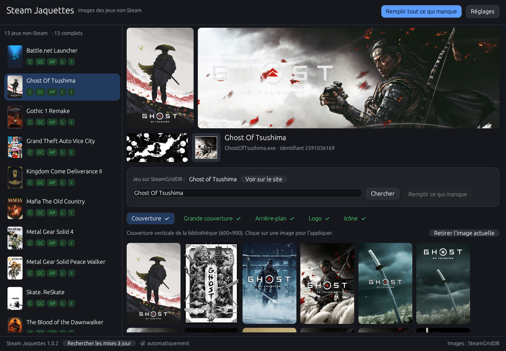
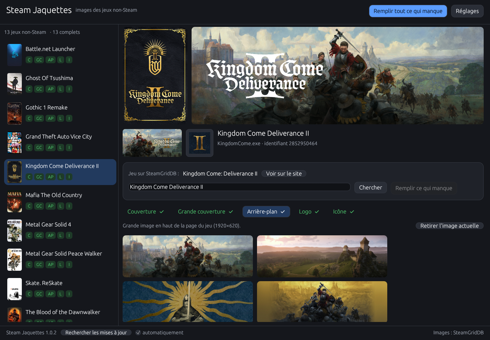
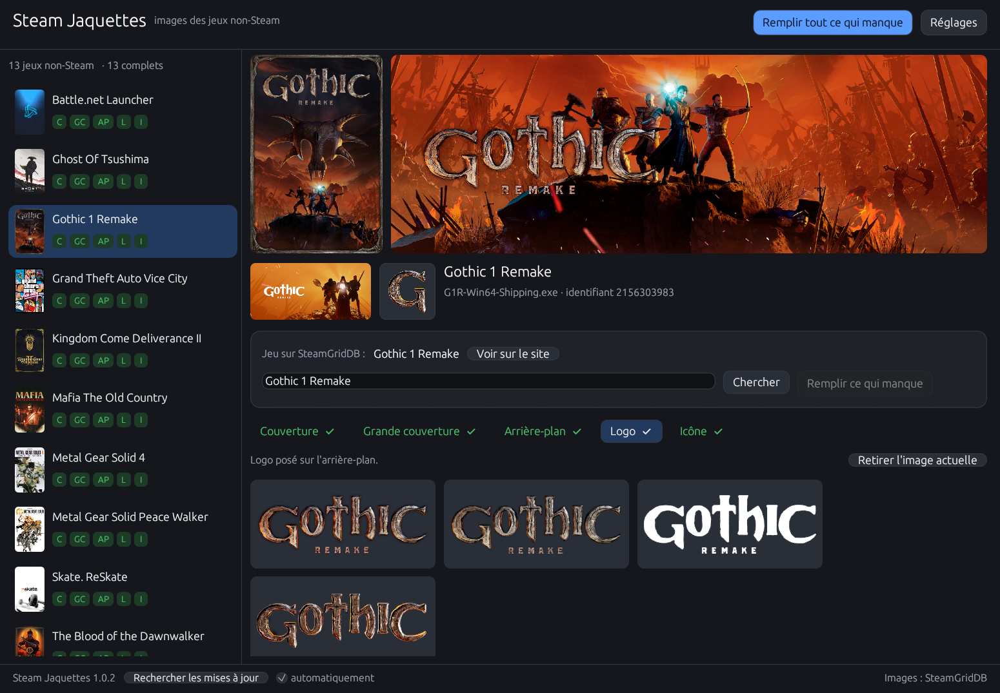

# Steam Jaquettes

**Des couvertures, arrière-plans, logos et icônes pour les jeux non-Steam de ta bibliothèque Steam, sous Linux.**

Quand on ajoute un jeu non-Steam (un `.exe` lancé avec Proton, un launcher, une AppImage…), Steam l'affiche sans image : une case grise dans la bibliothèque, pas d'arrière-plan, pas d'icône. Steam Jaquettes va chercher les images du jeu sur [SteamGridDB](https://www.steamgriddb.com/) et les installe là où Steam les attend, en un clic ou pour tous les jeux d'un coup.



## Fonctionnalités

- **Liste de tes jeux non-Steam**, lue directement dans Steam. Pour chaque jeu, 5 pastilles montrent ce qui est déjà en place : **C** couverture, **GC** grande couverture, **AP** arrière-plan, **L** logo, **I** icône. Un jeu ajouté dans Steam apparaît tout seul.
- **Aperçu façon bibliothèque Steam** : couverture, arrière-plan avec le logo par-dessus, grande couverture et icône.
- **Recherche automatique** du jeu sur SteamGridDB à partir de son nom dans Steam. Les préfixes de tri comme « z » ou « zz » sont ignorés. Si le jeu trouvé n'est pas le bon, tape un autre nom et choisis dans la liste.
- **5 onglets**, un par type d'image, avec toutes les images proposées sur SteamGridDB. **Un clic** sur une image l'applique.

  | Type | Où Steam l'affiche | Taille |
  |---|---|---|
  | Couverture | Bibliothèque (grille) | 600×900 |
  | Grande couverture | « Jeux récents », Big Picture | 920×430 |
  | Arrière-plan | En haut de la page du jeu | 1920×620 |
  | Logo | Posé sur l'arrière-plan | — |
  | Icône | Liste des jeux à gauche | — |

- **« Remplir ce qui manque »** pour un jeu, ou **« Remplir tout ce qui manque »** pour toute la bibliothèque : l'app prend l'image la mieux notée de chaque type. Elle ne remplace jamais une image déjà en place.
- **Images fixes seulement**, sans contenu adulte ni humoristique.
- **Plusieurs comptes Steam** sur le PC : un menu permet de choisir le compte.
- **Mises à jour intégrées** (voir plus bas).





## Installation

1. Télécharge `SteamJaquettes-x.y.z-linux-x86_64.AppImage` depuis les [Releases](https://github.com/VGioM/SteamJaquettes/releases/latest).
2. Rends-la exécutable (clic droit, Propriétés, « Exécutable », ou `chmod +x SteamJaquettes-*.AppImage`), puis lance-la.
   Sur Bazzite, tu peux aussi l'ouvrir avec **Gear Lever** pour l'ajouter au menu des applications.
3. Au premier lancement, l'app demande une **clé API SteamGridDB**. Elle est gratuite :
   1. connecte-toi sur [steamgriddb.com](https://www.steamgriddb.com/) avec ton compte Steam ;
   2. ouvre [Préférences, onglet API](https://www.steamgriddb.com/profile/preferences/api) et génère une clé ;
   3. colle-la dans l'app.

## Utilisation

1. Choisis un jeu dans la liste. L'app le cherche sur SteamGridDB et montre les images disponibles.
2. Clique sur les images que tu veux, onglet par onglet, ou utilise **« Remplir tout ce qui manque »**.
3. Si Steam est ouvert, un bandeau propose **« Redémarrer Steam »** : Steam se ferme proprement, les icônes sont enregistrées, puis Steam se relance avec les nouvelles images.

## Mises à jour

Au lancement, au plus une fois par jour, Steam Jaquettes regarde s'il existe une nouvelle version dans les [Releases](https://github.com/VGioM/SteamJaquettes/releases) et propose de l'installer. L'AppImage est téléchargée, vérifiée (empreinte SHA-256 publiée par GitHub), remplacée, et l'app se relance. Le bouton « Rechercher les mises à jour » est en bas de la fenêtre, et la recherche automatique peut être désactivée.

## Ce que l'app modifie

Tout se passe dans le dossier de ton compte Steam (`~/.local/share/Steam/userdata/<compte>/config/`, ou l'équivalent de la version Flatpak de Steam) :

| Fichier | Rôle |
|---|---|
| `grid/<id>p.png` | Couverture |
| `grid/<id>.png` | Grande couverture |
| `grid/<id>_hero.png` | Arrière-plan |
| `grid/<id>_logo.png` | Logo |
| `grid/<id>_icon.png` | Icône |
| `shortcuts.vdf` | Le chemin de l'icône y est écrit (champ `icon` du raccourci) |

`<id>` est l'identifiant que Steam donne au raccourci du jeu. Ce sont les mêmes fichiers que ceux créés par Steam quand on choisit une illustration personnalisée à la main.

**Sécurité de `shortcuts.vdf`** : l'app ne le modifie que **Steam fermé** (sinon Steam écraserait la modification), fait une copie de sécurité avant la première modification (`shortcuts.vdf.jaquettes-sauvegarde`), et ne touche qu'au champ `icon`. Elle vérifie d'abord qu'elle sait relire et réécrire le fichier à l'identique ; sinon, elle refuse de le modifier.

Les réglages (clé API, jeu SteamGridDB choisi pour chaque raccourci) sont dans `~/.config/SteamJaquettes/config.json`.

Pour revenir en arrière : supprime les fichiers `grid/<id>*` du jeu (ou utilise « Retirer l'image actuelle » dans l'app), et remets `shortcuts.vdf.jaquettes-sauvegarde` à la place de `shortcuts.vdf`, Steam fermé.

## Questions

**Les images n'apparaissent pas dans Steam ?** Steam ne relit le dossier des images qu'au démarrage : utilise le bouton « Redémarrer Steam » de l'app, ou quitte Steam complètement (menu Steam, Quitter) puis relance-le.

**Le mauvais jeu a été trouvé ?** Tape un autre nom dans le champ de recherche (souvent le nom anglais exact) et clique sur « Chercher », puis choisis le bon jeu dans la liste.

**Ça marche en mode Jeu (Game Mode) ?** L'app s'utilise depuis le mode Bureau. Les images, elles, s'affichent partout : bureau, Big Picture et mode Jeu.

## Compiler

Avec Rust stable :

```bash
cargo run --release          # lancer
./build-appimage.sh          # construire dist/SteamJaquettes-<version>-linux-x86_64.AppImage
```

`build-appimage.sh` a besoin de `mksquashfs` (squashfs-tools) et d'un runtime AppImage de type 2 (variable `APPIMAGE_RUNTIME`). Pour une AppImage compatible avec des systèmes plus anciens, compile dans un conteneur Fedora (distrobox) plutôt que sur un système très récent.

Pour publier une nouvelle version : augmente `version` dans `Cargo.toml` (1.0.3, puis 1.0.4…), construis l'AppImage, puis crée une release GitHub `vX.Y.Z` qui contient `SteamJaquettes-X.Y.Z-linux-x86_64.AppImage`. Les installations existantes la proposeront d'elles-mêmes.

L'interface utilise [egui](https://github.com/emilk/egui). Les images viennent de [SteamGridDB](https://www.steamgriddb.com/) et de leurs auteurs : pense à voter pour celles que tu utilises sur le site.

## Licence

[MIT](LICENSE) : tout le monde peut reprendre, modifier et améliorer Steam Jaquettes, tant que la mention de copyright est conservée.

Steam Jaquettes n'est ni lié à Valve ni à SteamGridDB. Steam est une marque de Valve Corporation.
